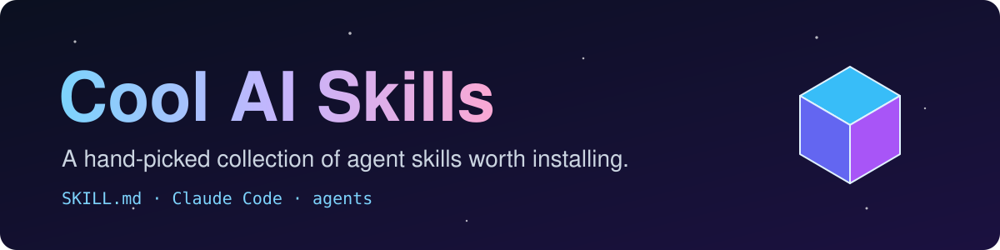

<div align="center">



<br/>


**A collection of cool AI skills I've found.**
Each one is a drop-in `SKILL.md` bundle for Claude Code and other skill-aware agents.

</div>

---

## Contents

| | Skill | What it does |
|---|---|---|
| 🚀 | [nasa-handbook](#-nasa-handbook) | Apollo-era NASA paperwork, rendered to PDF |
| 📐 | [anatomy](#-anatomy) | Interactive isometric SVG explainers |

---

## 🚀 nasa-handbook


> **Make printable technical documents in the style of Apollo-era NASA paperwork.**

Modelled on an Apollo Operations Handbook "Systems Data" page, with:

- a typed running head and numbered paragraphs
- Leroy-lettered line drawings and schematics
- a performance data table
- `NOTE` / `CAUTION` / `WARNING` notices
- a Flight Data File checklist card, a black thumb tab and a dated footer
- A4 or US Letter PDF output

**Use it for:** NASA-style or retro aerospace docs, spec sheets and one-pagers that should look like vintage engineering paperwork, or a handbook page explaining a product, codebase, system or fictional gadget.

**Try:** *"Make me an Apollo-style handbook page for my home server."*

**Source:** [R44VC0RP/skills → nasa-handbook](https://github.com/R44VC0RP/skills/tree/main/skills/nasa-handbook)

---

## 📐 anatomy


> **Build crafted, interactive isometric SVG figures that explain a technical idea as a real physical object.**

Think a test rig, a dial gauge, a cabinet of drawers, a plotter or a lock, with:

- many small, precise solid parts and four-tone shading
- correct painter's order
- a framed card with title, hint and live readout
- calm, eased motion
- optional WebGL shaders (fire, exhaust, water, caustics, lamp light) inside the drawing, in the same isometric perspective
- framework-free TypeScript/JS, or React/Next.js

**Use it for:** docs, blog posts, landing pages and articles, "Linear-style" premium technical drawings, or any SVG showing how a system, algorithm or component works.

**Try:** *"Draw how a rate limiter works as an isometric machine."*

**Source:** [wheresryan22/anatomy](https://github.com/wheresryan22/anatomy)

---

## Installing a skill

Copy the skill folder from its source repo into your skills directory:

```bash
# personal (all projects)
~/.claude/skills/<skill-name>/

# or per project
.claude/skills/<skill-name>/
```

Restart your agent and the skill will show up automatically.

---

<div align="center">
<sub>Skills belong to their original authors. Check each source repo for licence details.</sub>
</div>
